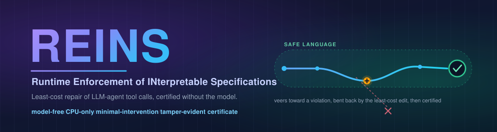

<div align="center">



<br/>

[](pyproject.toml)
[](LICENSE)
[](tests/)
[](#two-things-make-reins-different)
[](paper/reins.pdf)

**A certifying, model-free, minimal-intervention runtime _shield_ for LLM agents.
When an agent is about to break a temporal-safety policy, REINS does more than
detect it (too late) or block it (kills the task): it computes the
**least-cost enactable edit** that keeps the trajectory safe, and seals every
intervention into a certificate an auditor re-verifies _without the model_.**

</div>

---

A detector tells you the agent *did* something unsafe, after the fact. A
blocking guardrail *stops* the action, and with it the task: it cannot tell a
malicious transfer from a legitimate one that merely forgot its authorization
step, so it blocks both. **REINS** resolves the dilemma. On each tool call it
solves a tiny optimization exactly:

> among all edits the deployment can actually **enact** (inject a missing
> prerequisite like `authorize` or `audit_log`, substitute a safer tool variant,
> suppress, or defer to a human), keep the ones that leave the policy's monitors
> safe, and apply the **least-cost** one.

It runs on the same interpretable propositional / bounded-LTL substrate as the
companion systems [THGTM](../THGTM) and [TRACE](../TRACE), but it is the piece
they lacked: **enforcement**.

The accompanying paper is at [`paper/reins.pdf`](paper/reins.pdf).

## Two things make REINS different

1. **Model-free, CPU-only.** REINS edits the emitted tool-call stream *post hoc*,
   with **no model in the repair loop**, so it shields **black-box and closed
   agents** at a **226 µs** median per step. (Contrast: the nearest neighbour,
   Agent-C, repairs via in-decoder constrained generation, which needs model
   access.)
2. **A certificate of the enforcement _action_.** Every intervention is sealed
   into a tamper-evident, hash-chained log. An auditor re-verifies, *without the
   model*, that the executed trajectory was safe **and** that the shield
   intervened *as little as the policy allowed*, catching both **under**- and
   **over**-restriction.

> REINS does **not** claim to invent minimal-intervention enforcement, the
> soundness/transparency pairing, or the edit primitives; those come from edit
> automata (Ligatti et al. 2005), shield synthesis (Bloem 2015; Alshiekh 2018),
> optimal enforcement (Pandya 2019; Gallay and Falcone 2021), and certifying
> algorithms (McConnell 2011). REINS's contribution is their specific
> **model-free, certifying** instantiation for agent tool calls. See the paper's
> Related Work for the full lineage.

## Quick start

```bash
pip install -e ".[experiments,dev]"

python demo/quickstart.py          # wrap a mock agent: inject a prerequisite,
                                   # substitute a destructive call, rate-limit,
                                   # then seal + verify a certificate
python -m pytest                   # 62 unit tests, ~1s
python experiments/run_all.py      # regenerate every results/*.json (minutes, CPU)
python scripts/make_figures.py     # rebuild paper figures
python scripts/paper_numbers.py    # rebuild paper/_numbers.tex
```

```python
from reinskit import (Policy, always, never, bounded_count, response, precedence,
                      Action, AdapterConfig, ToolCallAdapter, Capabilities,
                      ShieldEngine, verify_shield)

policy = Policy("data-handling", [
    always("within_scope"),
    never("delete_all"),
    bounded_count("export", max_count=2, window=50),
    response("sensitive_read", "audit_log", deadline=3),  # auto-audited if forgotten
    precedence("authorize", "transfer"),                  # auto-authorized if forgotten
])
caps = Capabilities(
    substitutions={"delete_all": [Action.of("archive")]},
    insertables={"audit_log": Action.of("audit_log"),
                 "authorize": Action.of("authorize")})

eng = ShieldEngine("session-1", policy, caps, adapter, key=KEY)
dec = eng.observe(tool_call, provider="anthropic")   # returns the edit to enact
for a in dec.output_actions:                          # what to actually execute
    run(a)
cert = eng.seal()                                     # signed certificate
ok, info = verify_shield(eng.ledger.to_dict(), cert, key=KEY)   # model-free
```

## Headline results

All numbers from `python experiments/run_all.py` on a single CPU, 12 seeds.

| Experiment | Result |
|---|---|
| **Safety/utility frontier** (E1) | REINS: ASR **0.000**, Completion-under-Policy **1.000** vs blocking's CuP **0.328** at the same ASR 0; **3× the utility at identical safety.** |
| **Soundness** (E2) | shieldable deployment: **100%** of fuzzed sessions sound, **0** enforcement failures |
| **Transparency** (E3) | identity on compliant streams (intervention rate **0.000**) |
| **Minimal intervention** (E3) | **100%** of 8 394 committed edits certifiably least-cost; per-step == whole-trajectory optimum on **97.5%** of trajectories (honest: not all) |
| **Certificate** (E4) | 6 tamper classes + forgery detected at **100%**; over- **and** under-restriction caught in validly-signed logs |
| **Systems** (E5) | shield step **226 µs** median / 793 µs p99, 9.4 candidates; monitor state **386 B** (constant); ledger ~690 B/entry |
| **Robustness** (E6) | adaptive exfiltration **bounded** at the rate budget; every substitution **auditable** in the certificate |

## What's in the box

| Path | What it is |
|---|---|
| `reinskit/ltl.py`, `behavior_guard.py`, `policy.py` | bounded-LTL monitors + the policy DSL, with `clone`/`simulate` for planning |
| `reinskit/edits.py` | the edit algebra (allow / suppress / substitute / insert / defer) |
| `reinskit/enact.py` | the **enactability relation**, cost model, and static `is_shieldable` check |
| `reinskit/shield.py` | the least-cost repair planner (the core) |
| `reinskit/ledger.py` | tamper-evident certificate + model-free `verify_shield` (integrity + soundness + **minimality**) |
| `reinskit/engine.py`, `adapters.py` | the inline `ShieldEngine` + model-agnostic adapters |
| `reinskit/automata.py` | the vendored Echo-Trace Tsetlin substrate |
| `experiments/` | seven reproducible experiments (E1-E7) |
| `paper/reins.tex` | the paper source (compiles with `pdflatex`) |
| `tests/` | 62 unit tests |

## Honest limitations

This is v1.0; I am explicit about what does **not** hold:

- **Only as strong as its capabilities.** Remove the utility-preserving edits and
  REINS collapses to blocking; remove the escalation channel too and even
  soundness degrades (the static check warns you first).
- **Per-step, not global.** I prove and certify *per-step* minimality; it matched
  the whole-trajectory optimum on 97.5% of trajectories, not all.
- **Declared-policy coverage.** REINS enforces only constraints someone wrote;
  policy mining from logs is future work.
- **Substitutions are trusted.** A mis-declared "safe" variant is enacted, but
  recorded verbatim in the certificate, so the error is auditable.
- **Synthetic benchmark; symmetric authentication.** Trajectories follow published
  taxonomies but are not a live agent; the ledger is HMAC (Ed25519 is the drop-in
  upgrade).

See `paper/reins.pdf` §6-7 for the full discussion.

## Citing

```bibtex
@misc{debes2026reins,
  title  = {REINS: Model-Free, Certifying Least-Cost Repair of
            LLM-Agent Tool-Call Trajectories},
  author = {Debes, Anwar},
  year   = {2026},
  note   = {Reference implementation, v1.0}
}
```

## License

MIT. See [`LICENSE`](LICENSE).
